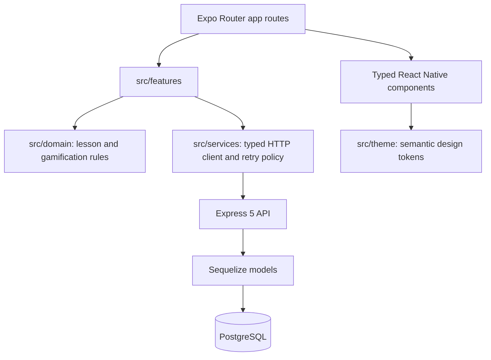

# CodePlay

[](https://github.com/Luizhbgf/CodePlay/actions/workflows/ci.yml) [](https://expo.dev/) [](https://www.typescriptlang.org/)

CodePlay is a gamified programming-learning app built with React Native, Expo Router, and TypeScript. Learners follow bite-sized tracks in TypeScript, Python, Java, and C++, practice with quizzes, and track XP, streaks, and achievements.

> **Portfolio note:** lesson catalog and progress shown in this UI are currently sample content held in memory. Supabase is connected to the Vercel project, but its live schema currently has no tables and this app is not yet wired to remote authentication or progress storage. Do not treat the sample XP as persisted account data. The local Express API and PostgreSQL Compose stack are a separate development scaffold.

## Product preview

<!-- Add updated product screenshots or a short lesson-flow GIF here. -->

## Architecture



```text
app/                         Expo Router routes and layouts (TypeScript only)
components/                  Shared React Native UI
src/domain/                  Explicit domain types, catalog, gamification rules
src/features/lessons/        Lesson UI, code display, quiz flows
src/services/                Typed HTTP client, API errors, bounded retries
src/theme/                   Semantic colors, spacing, and radius tokens
codeplay-backend/src/        TypeScript Express API and Sequelize model
.github/workflows/ci.yml     Typecheck, lint, unit tests, backend typecheck
```

## Quick start

### Expo app

```bash
npm ci
npm run typecheck
npm test
npm run web
```

For a device, run `npx expo start` and set `EXPO_PUBLIC_API_URL` to an API URL reachable from that device (not `localhost`). Course content is bundled for immediate offline access; the typed HTTP client provides bounded retries for future API-backed operations.

### Full local stack with Docker Compose

```bash
cp .env.example .env
# Change DB_PASSWORD before using this outside a local disposable environment.
docker compose up --build
```

The Expo web preview is served on port 8081 and the API on port 3000. PostgreSQL data is stored in the named `codeplay-postgres` volume. To discard local data, stop the stack and remove that volume deliberately.

### Backend only

```bash
cp codeplay-backend/.env.example codeplay-backend/.env
cd codeplay-backend
npm ci
npm run dev
```

`GET /health` reports API availability. User-directory endpoints are disabled until a server-side `ADMIN_API_TOKEN` of at least 32 characters is configured; they require `Authorization: Bearer <token>` and return a limited projection. This is an operator-only guard, not end-user authentication. Do not expose account or admin operations to the mobile client.

## Engineering choices

- **Expo Router:** route files stay declarative and typed; feature behavior is outside route definitions.
- **Strict TypeScript:** mobile and backend use strict TypeScript; request validation and API errors are explicit.
- **Domain-first gamification:** XP, level-progress, streak-bonus, and quiz-answer rules are pure functions with unit tests.
- **Offline-tolerant catalog:** educational catalog content is bundled, with a bounded retry policy for the optional HTTP service.
- **Privacy by default:** the API model never selects password hashes, salts, or emails for its public response projection.

### Short ADRs

1. **Use Expo Router rather than a custom navigation registry.** Deep links and route ownership remain aligned with the filesystem.
2. **Keep business rules framework-independent.** Pure TypeScript enables deterministic tests and future API reuse.
3. **Do not store progress in browser storage.** Durable per-user progress needs authenticated database ownership and RLS; it is intentionally not simulated with localStorage.
4. **Keep Supabase schema changes explicit.** The connected project currently has no tables; add reviewed migrations and RLS before wiring personal data.

## Quality checks

```bash
npm run typecheck
npm run lint
npm test
npm ci --prefix codeplay-backend
npm --prefix codeplay-backend run typecheck
```

GitHub Actions runs the same checks on pushes and pull requests. `src/domain/*.test.ts` covers XP, streak, level progress, and answer validation.

## Roadmap

- Add Supabase Auth and user-scoped progress after establishing the schema, RLS policies, and mobile runtime credentials.
- Add a server-authoritative immutable XP ledger to prevent client-side point manipulation.
- Extend lesson exercises with code execution in a sandboxed runtime; the current code panel is an educational renderer, not an execution sandbox.
